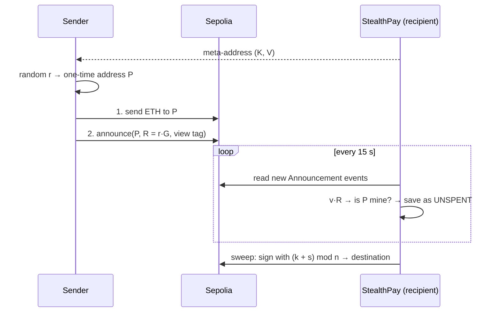

# StealthPay

Private ETH payments on the Sepolia testnet using **stealth addresses** ([ERC-5564](https://eips.ethereum.org/EIPS/eip-5564), scheme 1: secp256k1 with view tags).

A recipient shares one public **meta-address**. Every sender derives a fresh, one-time address from it, so no two payments
can be linked to each other or to the recipient. StealthPay is the recipient's backend: it scans the chain for payments
that belong to it, tracks them in PostgreSQL, and can later sweep the funds to any wallet. It also includes a demo sender,
so the full flow can be tried end to end.

> **Testnet only.** StealthPay is a portfolio project. It refuses to send transactions on any chain other than Sepolia.

## How it works



| Key | Who holds it | What it allows |
|---|---|---|
| Spending key pair `k`, `K = k·G` | Recipient | `k` is needed to **spend**. It's only read when sweeping. |
| Viewing key pair `v`, `V = v·G` | Recipient (server) | `v` can **find** payments but can't spend them. |
| Ephemeral key `r`, `R = r·G` | Sender, new for every payment | `R` is published so the recipient can derive the shared secret. |

**The math:**

- **Shared secret:** the sender computes `S = r·V` and the recipient computes `S = v·R`. Both get the same point.
- **Stealth address:** `s = keccak256(S)`, `P = K + s·G`, and the stealth address is the Ethereum address of `P`.
- **Spending key:** the private key of `P` is `(k + s) mod n`, which only the recipient can compute.
- **View tag:** the first byte of `s`. The scanner compares it first, which rules out about 255 of every 256 other people's
  announcements without the costly address check.

## Tech stack

Java 21 · Spring Boot 4 · web3j · Bouncy Castle (secp256k1, Keccak-256) · PostgreSQL 17 · Spring Data JPA · Flyway ·
Bean Validation · Lombok · JUnit 5 · Mockito · Testcontainers · Docker

## Project structure

```
com.example.stealthpay
├── crypto       Pure Java ERC-5564 math: keys, meta-address, stealth address generation and checking
├── chain        Sepolia access via web3j: send, announce, read announcements, balances, sweep
├── scanner      Scheduled job that finds incoming payments
├── sweep        Moves every UNSPENT payment to a destination address
├── persistence  JPA entities and repositories
├── config       Typed configuration, plus hand-run key and address tools
├── api          REST controllers and error handling
└── dto          Request and response records
```

`crypto` depends on nothing else in the project, and controllers contain no business logic.

## Getting started

### Prerequisites

- Docker (to run the app, and for the integration tests)
- JDK 21 (to run the tools and the tests locally)
- A Sepolia RPC URL, for example from Alchemy or Infura
- Some Sepolia ETH from a faucet, for the demo sender wallet

### 1. Generate the recipient keys

Run `com.example.stealthpay.config.KeyGenerator` from your IDE. It prints the `.env` lines for `k`, `v` and `K`, plus your
meta-address. The output contains private keys, so don't save it anywhere except `.env`.

### 2. Configure

```bash
cp .env.example .env
```

Fill in `.env` (see [Configuration](#configuration)). Then run `com.example.stealthpay.config.SenderAddress` to print the
demo sender's address, and fund that address from a Sepolia faucet.

### 3. Run

```bash
docker compose up --build
```

This starts PostgreSQL 17 and the app on `http://localhost:8080`. Flyway creates the schema on the first start.

### 4. Try the flow

```bash
# Get your meta-address
curl http://localhost:8080/api/meta-address

# Pay yourself 0.001 ETH (takes ~15–30 s)
curl -X POST http://localhost:8080/api/payments/send \
  -H "Content-Type: application/json" \
  -d '{"metaAddress": "st:eth:0x...", "amountWei": "1000000000000000"}'

# After ~12 confirmations (~2.5 min) the scanner finds it
curl http://localhost:8080/api/payments
curl http://localhost:8080/api/balance

# Move everything to a wallet of your choice
curl -X POST http://localhost:8080/api/sweeps \
  -H "Content-Type: application/json" \
  -d '{"destination": "0x..."}'
```

## API

Base URL: `http://localhost:8080/api`. All bodies are JSON. Amounts are in **wei**, and request amounts are strings
because wei values can exceed a 64-bit integer.

### `GET /meta-address`

Returns the meta-address to share with senders. It's computed from `K` and `V` on every call and never stored.

```json
{ "metaAddress": "st:eth:0x02…(K, 33 bytes)…03…(V, 33 bytes)…" }
```

### `GET /payments`

Lists the payments found by the scanner.

| Query parameter | Required | Values |
|---|---|---|
| `status` | no | `UNSPENT` or `SWEPT`. Leave it out to get all payments. |

```json
[
  {
    "stealthAddress": "0x1f9a…",
    "amountWei": 1000000000000000,
    "txHash": "0x8c2e…",
    "blockNumber": 7123456,
    "status": "UNSPENT"
  }
]
```

`txHash` is the hash of the announce transaction. `amountWei` is the real on-chain balance of the stealth address, never
the amount claimed in the announcement.

### `GET /balance`

Returns the total of all `UNSPENT` payments, read from the database.

```json
{ "balanceWei": 1000000000000000 }
```

### `POST /payments/send`

Demo sender. Pays a meta-address from the sender wallet in two transactions: the ETH transfer, then the announcement. It
waits until both are mined (~15–30 s).

| Field | Rule |
|---|---|
| `metaAddress` | `st:eth:0x` + 132 hex characters |
| `amountWei` | Positive whole number as a string, up to 78 digits |

```json
{ "metaAddress": "st:eth:0x…", "amountWei": "1000000000000000" }
```

Response:

```json
{
  "stealthAddress": "0x1f9a…",
  "transferTxHash": "0x4b7d…",
  "announceTxHash": "0x8c2e…"
}
```

### `POST /sweeps`

Moves the ETH from every `UNSPENT` stealth address to `destination`, then marks each payment `SWEPT`. Each stealth address
pays its own gas, so a little dust stays behind. A payment whose balance can't cover the gas is skipped. It waits for every
transaction to be mined.

| Field | Rule |
|---|---|
| `destination` | `0x` + 40 hex characters |

```json
{ "destination": "0x…" }
```

Response, with one entry per swept address (`txHash` is the sweep transaction, `amountWei` is what reached the destination):

```json
[
  { "stealthAddress": "0x1f9a…", "txHash": "0x9e01…", "amountWei": "995800000000000" }
]
```

### Errors

Errors come back as `{"error": "message"}`, never as a stack trace.

| Status | When |
|---|---|
| `400 Bad Request` | Invalid input. A body that fails validation gets Spring's default 400 response. |
| `500 Internal Server Error` | Misconfiguration (for example, the spending key isn't set) or a transaction that failed on chain |
| `502 Bad Gateway` | The Sepolia node couldn't be reached, or a transaction wasn't mined in time |

## Configuration

All settings come from environment variables. `docker compose` loads them from `.env`, which is git-ignored. The template
is `.env.example`.

| Variable | Required | Description |
|---|---|---|
| `POSTGRES_DB`, `POSTGRES_USER`, `POSTGRES_PASSWORD` | yes | Database name and credentials |
| `SEPOLIA_RPC_URL` | yes | Sepolia JSON-RPC endpoint |
| `STEALTHPAY_VIEWING_PRIVATE_KEY` | yes | `v`, used to find payments |
| `STEALTHPAY_SPENDING_PUBLIC_KEY` | yes | `K`, 33-byte compressed hex |
| `STEALTHPAY_SPENDING_PRIVATE_KEY` | for sweeps | `k`. The app can run and scan without it. |
| `STEALTHPAY_SENDER_PRIVATE_KEY` | yes | Demo sender wallet |
| `STEALTHPAY_SCAN_START_BLOCK` | yes | First block to scan. It's only used on the very first start. |
| `STEALTHPAY_CONFIRMATIONS` | no (12) | How many blocks deep an announcement must be before it's read |
| `STEALTHPAY_MAX_BLOCKS_PER_BATCH` | no (500) | Blocks per `eth_getLogs` call. Use `10` on Alchemy's free tier. |

## Design notes

- **No block is ever skipped.** Each scan run saves its new payments and its scan progress in a single database
  transaction. If anything fails, both roll back and the next run retries the same blocks.
- **No payment is saved twice.** `(tx_hash, log_index)` is unique, both in a check before saving and as a database
  constraint.
- **Reorg safety.** The scanner only reads blocks that are at least `STEALTHPAY_CONFIRMATIONS` deep.
- **Nothing trusted from announcements.** Anyone can call `announce()`. Malformed logs are skipped, and amounts come from
  the chain rather than from the announcement's metadata.
- **Sweeps are recorded one by one.** An on-chain transfer can't be rolled back, so each payment is marked `SWEPT` right
  after its own transaction is mined, rather than in one big database transaction.
- **Gas is estimated, not hard-coded.** A transfer to a new account, which a stealth address always is, costs far more
  than 21,000 gas on Sepolia. Gas limits come from `eth_estimateGas` plus a 20% margin.
- **No private keys in the database.** Only `R` is stored, and the stealth key is derived again when sweeping. Every
  config `toString()` hides secrets.

### Known limitations

- **Sweeping links addresses.** Sending every stealth address into one destination links them on chain.
- **A failed announce strands the payment.** If the transfer succeeds but the announce fails, `R` is lost and that ETH
  can't be recovered.
- **ETH only.** Token payments and a gasless sweep through a relayer aren't implemented.

## Testing

```bash
./mvnw test        # Windows: .\mvnw.cmd test
```

Docker must be running, because integration tests start PostgreSQL with Testcontainers.

| Type | What it covers |
|---|---|
| Unit | The crypto classes, tested against known vectors (private key `1` → `0x7e5f4552091a69125d5dfcb7b8c2659029395bdf`), plus log decoding, announce encoding, gas math and config validation |
| Web slices | One `@WebMvcTest` per controller: status codes, JSON shape, validation and error mapping |
| Integration | `@SpringBootTest` with a real PostgreSQL: scanner, sweep, repositories, and a full scan → balance → sweep flow over HTTP. Only the beans that talk to the Ethereum node are mocked. |

## Security

- Never commit `.env`, private keys, or RPC URLs that contain API keys.
- The viewing key on the server can only find payments. The spending key is only needed for sweeping and can be left out
  of a scan-only deployment.
- The Docker image runs as a non-root user on a JRE-only base image.
